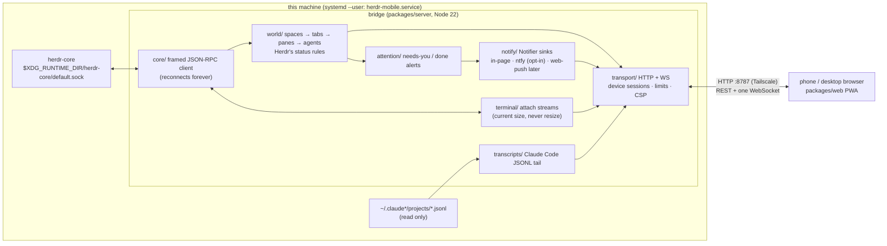

# herdr-mobile: guide

Herdr on your phone. A live-syncing web app (phone first, desktop Chrome too) that mirrors the Herdr desktop app:
spaces and their status, the agents and terminals in each space, one agent's live terminal (type into it from the
phone, quick keys, one-tap answers), a Conversation tab built from Claude Code transcripts, and in-page alerts when an
agent needs you or is done. Installable as a PWA on iOS and Android.

It reads from Herdr and types into terminals, and it can make a new space or add a tab to one (the only structural
things it does). It
never writes Herdr's layout document or `herdr.pinned` (enforced in `packages/server/src/core/policy.ts`), and it
never resizes a terminal (the phone scales instead:
readable 11 px text that pans sideways with the cursor by default, "Fit" for the whole grid; see `terminal/zoom.ts`).

### Terminal history

Scroll up in the Terminal view and older output loads as you go (like the Conversation tab): the rows above the
live screen are the terminal's own history, with their colors, fetched a page at a time from the bridge, which
keeps what herdr-core holds for the terminal (about 5 MB of rows per terminal: ~3000 rows at 200 columns)
plus what scrolled by since, up to 6000 rows; the page keeps up to 5000. The top says where it ends ("Start of
history" or a cap). Read only: nothing is typed and nothing is resized.

A full-screen app (Claude Code, less, vim) draws on the alternate screen and keeps its history to itself, so there
is no terminal history above it. Its note has **Read earlier output**: herdr-core reads it the way `hc read --lines`
does, by scrolling the app up with the mouse wheel and back (its live view pauses for those seconds; keys typed
meanwhile wait), as plain text, at most 1000 lines, and not while the app is working or blocked. The Conversation
tab has an agent's whole chat.

### New space

The **+** on the spaces screen (the desktop layout: next to "Spaces" in the sidebar) makes a space: a folder (an open
or recently closed space's, or typed with completion inside your home folder), an optional name, and what runs
first: a terminal, or any agent Herdr's own **+** menu offers that is installed (same table and the same
`command -v` check in your interactive shell; the core's `hc templates` too). The app opens the new space (or the
agent) as soon as it shows up.

How: the bridge starts the space's first terminal exactly the way herdr-app's `space.new` does (labels
`herdr.space`/`herdr.tab` with fresh ids, `herdr.seen=0`, kept, herdr-app's env, an agent inside your interactive
shell) and the Herdr window adopts it ("an id Herdr doesn't know becomes a new space", herdr-app AGENTS.md), so
Herdr writes its own document and the space is appended last like a desktop-made one. A name is given through the
window's `space.rename`. The window must be open (otherwise the app says so and starts nothing); a terminal it
doesn't adopt within 10 s is ended and removed. Folders must exist and lie inside your home folder (after symlinks)
or be an existing space's folder; at most 6 new spaces per 10 minutes. Closing it: end its terminal (or close the
space in Herdr); Herdr then lists it under Recent, as it does for any closed space. Live check:
`node scripts/check-new-space.mjs` (makes one space on a private bridge, checks it, removes it).

### New tab in a space (+)

A space's **+** (its top bar on a phone; after the tabs on the desktop layout) offers **Terminal** or **Claude
session**; Claude then offers **New session** or **Resume session**, which lists the Claude Code sessions of the
space's folder, newest first (title or first prompt, last activity, messages, and the login when there are several).
A session already running in a terminal Herdr shows says **Open** and opens that terminal; one running elsewhere
can't be resumed twice. With several Claude logins (`~/.claude`, CLAUDE_CONFIG_DIR folders like `~/.claude-work`,
even when their `projects` is a symlink to one shared folder), **Resume with** picks the login; by default a session
resumes with its own (the login whose `.claude.json` names it the folder's last session, else the default one).

How: like New space, but with the space's own `herdr.space` id and a fresh `herdr.tab` id, so the Herdr window adopts
the terminal as a new tab of that space (as the desktop's + menu `tab.new` does, without switching what the desktop
shows). The folder is that of the space's first terminal (else the space's). Terminal = the shell; New = Claude Code
as the + menu starts it (`$SHELL -ic '"$@"; exec "$0" -i' $SHELL claude`, tab named "Claude Code" through the
window's `tab.rename`); Resume = the same plus `--resume <id>`, with `env CLAUDE_CONFIG_DIR=<login folder>` in front
for a non-default login. Policy admits only those shapes, only runs the bridge announced for a space it shows, and a
resume only of a session whose transcript is in that folder's project folder of that login. Transcripts are only
read. Same limits as New space (one at a time, 6 per 10 minutes). Live check: `node scripts/check-space-plus.mjs
<folder> <session-id>` (a throwaway space in `<folder>`, all three on iPhone/Pixel/desktop, then removed).

## Architecture



| Package | What |
|---|---|
| `packages/protocol` | Typed, versioned messages shared by bridge and app (world snapshot + patches, alerts, terminal and conversation streams). |
| `packages/server` | The bridge: herdr-core socket → world model → WebSocket/REST; serves the built web app. |
| `packages/web` | The PWA: Vite + React + xterm.js, Herdr's graphite design (see packages/web/README.md). |
| `packages/e2e` | Playwright end-to-end suite: iPhone (WebKit), Android (Pixel 7) and desktop viewports. |
| `deploy/` | The systemd `--user` unit template. |

## Commands

Node 22 via fnm (`.node-version`); system Node 18 is too old.

```
npm install
npm run build          # protocol + server (tsc) and web (vite) -> packages/*/dist
npm start              # the built bridge on 127.0.0.1:8787 + this machine's Tailscale address
npm run dev            # bridge with live reload (tsx); plus `npm run dev:web` for Vite on :5173
npm run typecheck && npm run lint && npm test     # tsc, biome, vitest (unit + fake-core end to end)
npm run e2e            # Playwright e2e (needs a running Herdr; see below)
```

### Deploy (systemd --user)

```
scripts/install-service.sh        # build, install ~/.config/systemd/user/herdr-mobile.service, enable, (re)start
scripts/uninstall-service.sh      # stop, disable, remove (keeps the token)
systemctl --user status herdr-mobile
journalctl --user -u herdr-mobile -f
```

The install script is idempotent: re-run it after pulling or after editing `deploy/herdr-mobile.service`. It puts an
absolute fnm Node 22 path in the unit (no shell profile needed; `NODE_BIN=/abs/node` overrides), sets `Restart=always`
(back within ~1 s after a crash), `XDG_RUNTIME_DIR=%t` for the core socket, and logs to journald. It enables linger
when that works without sudo, so the service starts at boot. Local settings go in `~/.config/herdr-mobile/env`
(`KEY=value` lines, read by the unit). The service runs `packages/server/dist` from this checkout: after a new
`npm run build`, run the script again (or `systemctl --user restart herdr-mobile`).

If Herdr isn't running, the bridge still starts, `/api/health` says `"status":"degraded"`, and it connects as soon as
herdr-core is back (and again after every core restart).

### End-to-end tests

`npm run e2e` runs `packages/e2e` 3 ways (iPhone 15 on WebKit, Pixel 7 and 1440x900 desktop on Chromium):

- against the production service on :8787, read only (never opens an agent, so nothing is marked seen): health and
  versions, PWA manifest/icons/service worker, session required, security headers, sign-in link, spaces list =
  `/api/world`, clients reconnect after `systemctl --user restart herdr-mobile` (skipped if the service isn't running);
- against its own bridge on 127.0.0.1:8788 (same build, `HERDR_MOBILE_INCLUDE_UNPLACED=1`, `HERDR_MOBILE_SEEN_SYNC=0`)
  with two throwaway terminals (`hm-e2e-sh`, a bash, and `hm-e2e-conv`, `scripts/fake-agent.py` writing a synthetic
  transcript): sign in, spaces list, space → agent, terminal renders, typing echoes, quick keys (^C), Conversation tab
  live, alert toast, reconnect after a bridge restart, failed sign-in rate limit, signed-in devices in Settings (sign
  out, sign in again); the terminal's size never changes and the token never reaches the log, a request URL, a cookie
  or localStorage. Everything it starts is torn down at the end.

WebKit needs `libavif16`, which this host lacks (installing it needs sudo): `npm run webkit-libs -w @herdr-mobile/e2e`
unpacks it into `.test-tmp/` without sudo and the config preloads it into WebKit only. Without it the iPhone project
falls back to Chromium with iPhone emulation (`E2E_IPHONE_ENGINE=chromium` forces that).

Live checks used while building: `node scripts/smoke-ws.mjs`, `scripts/check-web.mjs`, `scripts/check-conversation.mjs`,
`npm run check:terminal`, `npm run check:security` (below).

## Security

The rule: from any network, the only way in is the token. Plain HTTP, so:

- **Where it listens.** Loopback and this machine's Tailscale address only (`HERDR_MOBILE_BIND` unset =
  `loopback,tailscale`). Nothing on the Wi-Fi, docker bridges or any other network: connections there are refused.
  Tailscale is WireGuard-encrypted end to end (at home too: the phone connects directly over the LAN, encrypted), so
  phones use `http://<tailscale-ip>:8787` everywhere and need Tailscale on. The address is re-checked every 5 s: when
  Tailscale goes down the bridge stays on loopback only, and it listens again when Tailscale comes back (on its new
  address if it changed). On the Tailscale address only tailnet peers (100.64.0.0/10) or this machine get a
  connection. Optional: `HERDR_MOBILE_ALLOW_PEERS=100.x.y.z,100.a.b.c/32` admits only those peers (your phones).
- **LAN only by opt-in, and it is cleartext.** `HERDR_MOBILE_BIND=loopback,tailscale,lan` (Wi-Fi/Ethernet) or `all`
  (docker bridges too) or an IP adds those addresses; the bridge warns at start. On them the sign-in token, the
  session cookie, every keystroke and every screen cross that network in the clear, and an on-path attacker can rewrite
  the app as it passes; assets are then served `no-store` so a rewritten one can't stay cached. Don't, unless that
  network is yours alone.
- **The token is used once per device.** It's a 256-bit random value in `~/.config/herdr-mobile/token` (0600). The
  sign-in link is `http://<tailscale-ip>:8787/#token=<token>`: the token is in the URL fragment, which browsers never
  send to the server; the page takes it out of the address at once and exchanges it (`POST /api/session`, JSON) for
  this device's session: a random 256-bit id in an `HttpOnly; SameSite=Strict` cookie (`Secure` over HTTPS). The
  bridge keeps only its SHA-256, in `~/.config/herdr-mobile/sessions.json` (0600, written atomically). The REST API and
  the WebSocket accept only that cookie (never a token in a URL; nothing auth-related in localStorage). A session
  unused for 90 days expires. Pasting the link or the token into the sign-in screen does the same. Old `?token=` links
  are not accepted (they are only redirected to the plain page). Tools on this machine may send the token as
  `Authorization: Bearer <token>` over loopback; never over the network.
- **Devices.** Settings → Signed-in devices lists each session (name from its browser, when it signed in, last seen,
  address) with Sign out per device and Sign out everywhere; a signed-out device's open connection closes at once.
  Sign-ins, failed sign-ins and devices connecting (once a day per address) are logged (`journalctl --user -u
  herdr-mobile`), never the token or a session id.
- **Rotating the token:** `scripts/rotate-token.sh` (or `npm run token:rotate`) writes a new one; the old one stops
  signing in at once, signed-in devices stay signed in. `scripts/rotate-token.sh --all` also signs every device out.
  `HERDR_MOBILE_TOKEN`, if you set one, must be at least 32 characters.
- **Failed sign-ins** (a wrong token at `POST /api/session`) are limited per address (30 per 10 min, then 429 for
  10 min). Only token attempts count: requests from other sites' pages are refused with 403 before they could count
  (Fetch Metadata / `Origin`; the API takes JSON only, which no form can send), and the fragment link never reaches the
  server, so a web page can't burn a phone's attempts. A signed-in device is never blocked.
- **Before signing in** a client may load the app shell (`/`, `/assets/*`, icons, sounds, manifest, `sw.js`), get
  `{"ok":true}` from `/api/health`, and present the token. Everything else is 401 (HTTP and the WebSocket upgrade,
  refused before the upgrade), 403 for other sites' pages, 421 for unknown host names; no CORS headers are ever sent.
- **Limits:** headers within 10 s of connecting, a whole request within 15 s, idle keep-alive 5 s; 512 connections on
  the network listeners, 32 per peer address, 8 WebSockets per peer; request bodies 64 KiB (1 KiB without a session).
  A refused request (401/403/413/421/429) closes its connection instead of reading what's left of it.
- **Host names** (DNS rebinding): exactly the addresses the bridge listens on, `localhost` on loopback, plus
  `HERDR_MOBILE_ALLOWED_HOSTS` (comma-separated, e.g. the MagicDNS name behind `tailscale serve`). Others get 421.
- **Headers** on every response, errors included: CSP (`script-src 'self'`, no inline scripts, `frame-ancestors
  'none'`, ...), `nosniff`, `X-Frame-Options: DENY`, `Referrer-Policy: no-referrer`, COOP/CORP, a restrictive
  Permissions-Policy. Error bodies are generic. No source maps are built or served.
- Only the core methods the bridge uses are allowed (an allowlist in `core/policy.ts`); it never writes the layout
  document or labels other than `herdr.seen`, and its typing never changes a terminal's size. `terminal.run` only in
  herdr-app's exact new-space shape (the shell, or an offered agent/template); `terminal.kill`/`rm` only for terminals
  it started; on the Herdr window's socket only `status` and `space.rename` of a space it made.
- `npm run check:security -- --target http://127.0.0.1:8787 --target http://<tailscale-ip>:8787` replays the
  unauthenticated probes of the security audit against a running bridge (and checks this machine's other addresses
  refuse connections); it signs in once with the token and signs out again.

### Claude accounts

Like the desktop's my-agents list, each local Claude agent shows the login it runs under, "alice, pro" (the email's
name part, the plan), left of its age: space screen rows, the desktop layout's agents list (where other agents show
their program, as my-agents does) and the agent screen's header. The bridge finds every `claude` process in `/proc`,
takes its `HC_TERMINAL_ID` and `CLAUDE_CONFIG_DIR` (else `~/.claude.json`), and reads only `oauthAccount.emailAddress`
(the part before `@`) and `planDisplayName`/`organizationType` from that file (re-read when its mtime changes; never
logged). Same result as my-agents' `accounts.py`; re-checked every 10 s and as soon as a terminal starts or leaves
`claude`. Terminals on other machines get none. Off: `HERDR_MOBILE_ACCOUNTS=0`. Live check:
`node scripts/check-accounts.mjs` (compares /api/world with `accounts.py`, read only).

## Configuration

Environment (`HERDR_MOBILE_*`, in `~/.config/herdr-mobile/env` for the service): `BIND` (`loopback,tailscale`; a
comma-separated list of `loopback`, `tailscale` (this machine's 100.x address, followed as it comes and goes), `lan`,
`all` and IP addresses; loopback is always included; see Security before adding a LAN), `ALLOW_PEERS` (empty: any
tailnet peer), `ALLOWED_HOSTS`, `PORT` (8787), `CORE_SOCKET` (else `HC_SOCKET`, else
`$XDG_RUNTIME_DIR/herdr-core/${HC_SESSION:-default}.sock`), `CONFIG_DIR`, `TOKEN`, `SEEN_SYNC` (1: opening a done agent
marks it seen like the desktop; 0 off), `LOG_LEVEL` (info; debug adds one line per request), `TRUST_PROXY` (1 behind
`tailscale serve`), `AUTH_MAX_FAILURES` (30, 0 = off), `AUTH_BLOCK_MS` (600000), `DONE_GRACE_MS` (1200),
`HEARTBEAT_MS` (15000), `STREAM_GRACE_MS` (10000), `INCLUDE_UNPLACED=1` (diagnostics/tests: also list terminals that
are in no pane), `ACCOUNTS` (1: Claude account per agent; 0 off), `DIAG_FILE` (absolute; default
`~/.local/state/herdr-mobile/diag.jsonl`, see Diagnostics), `TRANSCRIPT_ROOTS` / `TRANSCRIPT_OVERRIDE` (test hooks).

`GET /api/health`: public `{ "ok": true }` only; signed in (or the token from a loopback tool) `{ ok, status: "ok" |
"degraded", core: { connected, version, name, forS, reconnects, lastError }, bridge: { version, protocol,
conversationProtocol, node, startedAt, uptimeS, clients, webBuild } }`. (`HERDR_MOBILE_HOST` is no longer used: the HTTP
server listens on loopback and `BIND` adds the rest.)

### Diagnostics

A page from an older build reloads by itself once the bridge serves a newer one (never while a text field has focus,
at most once per build): a home-screen app on iOS is resumed rather than reloaded, so it could otherwise run an old
build for days. Settings > Diagnostics shows this page's build (git sha + build time).

Settings > Diagnostics > **Record events** keeps the last 300 events on the device: screens visited, connection
changes, errors and unhandled rejections, taps on buttons and links (by tag and class), the app going to the
background. Never recorded: what is typed or shown, cookies, tokens, the address's query. **Send to bridge** posts
them with the build, user agent and display mode to `POST /api/diag` (signed-in device session only, 48 KiB, 6 a
minute / 60 an hour per device); the bridge sanitizes them again and appends one JSON line each to
`~/.local/state/herdr-mobile/diag.jsonl` (0600; moved to `diag.jsonl.1` past 2 MiB).

### Phone notifications (ntfy, off by default)

Works on plain HTTP and with the app closed: the bridge posts each alert (same triggers as the desktop: needs you /
finished) to an [ntfy](https://ntfy.sh) server, and the ntfy app on the phone shows it. **Turning it on sends the
alert's title and place (the agent's name, `space / tab`) to that server**; with `HERDR_MOBILE_NTFY_PRIVATE=1` it sends
only "An agent needs you" / "An agent finished". Nothing is sent for an agent you are looking at in the app.

1. Pick a long random topic (it is the password to the feed): `openssl rand -hex 16`.
2. On the phone: install ntfy (App Store / Play Store / F-Droid), "Subscribe to topic", enter the topic (and your
   server if you self-host).
3. In `~/.config/herdr-mobile/env`:

       HERDR_MOBILE_NTFY_TOPIC=<topic>
       # optional:
       HERDR_MOBILE_NTFY_SERVER=https://ntfy.sh         # default; or your own ntfy server
       HERDR_MOBILE_NTFY_TOKEN=<access token>           # for a protected topic / self-hosted auth
       HERDR_MOBILE_NTFY_CLICK=http://<tailscale-ip>:8787    # tapping the notification opens that agent
       HERDR_MOBILE_NTFY_PRIVATE=1                      # no names or places in notifications

4. `systemctl --user restart herdr-mobile`; the log says `ntfy notifications on`. Remove the lines to turn it off.

At most 20 posts a minute; failures are logged without the topic or token.

## Later: HTTPS, system notifications and Web Push

Browsers only allow system notifications, Web Push and a full service worker in a secure context, so on plain HTTP the
alerts show inside the open page (toast, sound, vibration, title badge). HTTPS through Tailscale, when you want it:

1. Once, with sudo: `sudo tailscale set --operator=$USER`, and turn on MagicDNS + HTTPS certificates in the Tailscale
   admin console (DNS page).
2. `tailscale serve --bg 8787` (terminates TLS for `https://<machine>.<tailnet>.ts.net` with a Tailscale cert and
   proxies to the bridge).
3. In `~/.config/herdr-mobile/env`: `HERDR_MOBILE_TRUST_PROXY=1` (cookie gets `Secure`, the rate limit sees real
   peers), `HERDR_MOBILE_ALLOWED_HOSTS=<machine>.<tailnet>.ts.net`, optionally `HERDR_MOBILE_BIND=loopback` so only
   the HTTPS door stays open; then `systemctl --user restart herdr-mobile`.
4. Open `https://<machine>.<tailnet>.ts.net/#token=...` on the phones (re-add to the home screen from that URL).
   System notifications then work in the open app (allow them in Settings → Alerts).

Web Push (alerts with no page open) is a drop-in after that: `packages/server/src/notify/webpush.ts` describes the
steps (VAPID keys in `~/.config/herdr-mobile/vapid.json`, `POST /api/push/subscribe`, the `web-push` package, register
the sink next to `InPageSink` in `app.ts`); the web app's service worker already has the `push`/`notificationclick`
hooks to fill in. (ntfy, above, already works without HTTPS.)
